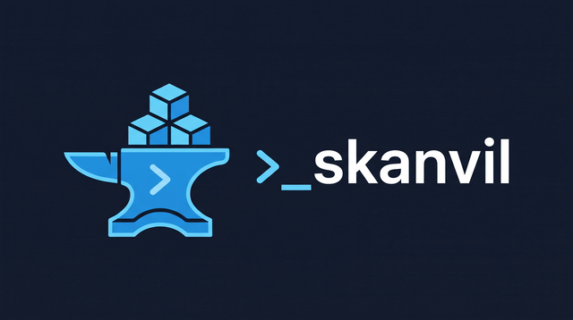

<p align="center">
  
</p>

# skanvil

[](https://github.com/jmbargueno/skanvil/actions/workflows/ci.yml)
[](https://www.npmjs.com/package/skanvil)
[](LICENSE)

**Forge, validate and ship libraries of [Agent Skills](https://agentskills.io/specification).**

skanvil is a CLI and Node.js library for teams that maintain a shared set of agent skills, such as a frontend review checklist, a backend migration playbook or an internal release workflow. Each skill lives in its own `SKILL.md`. skanvil handles the repetitive work around them:

- **Scaffolds** new skills from templates, with the right folder prefix, frontmatter and README entry.
- **Keeps everything in sync** when you rename, re-categorise or delete a skill.
- **Validates** every skill against the Agent Skills spec and your own conventions, locally or in CI.
- **Installs** the skills into the folders that coding agents read (`.claude/skills`, `.github/skills`, `.agents/skills`), in any project.
- **Teaches agents to use it.** skanvil ships its own `skanvil` agent skill, so Claude Code, Copilot or Codex working in your library run the CLI correctly instead of editing folders and the README by hand.

## What is a skills library?

A git repository (and optionally an npm package) with this layout:

```text
my-skills/
├── skills/
│   ├── front-api-review/      # one folder per skill
│   │   ├── SKILL.md           # YAML frontmatter + instructions
│   │   ├── references/        # optional long-form guidance
│   │   ├── scripts/           # optional helpers
│   │   └── assets/            # optional templates
│   └── back-migrations/
├── .claude/skills/skanvil/    # the skanvil agent skill, installed by `init`
├── README.md                  # human-readable index, maintained by skanvil
└── .skanvilrc.json            # categories, validation rules, sync targets
```

Skills are grouped into **categories**, and each category has a folder prefix and a README section. Out of the box these are `front-`, `back-`, prefix-less _transversal_ skills and `_internal` skills. You can define your own categories in `.skanvilrc.json`.

## Install

```bash
npm install --save-dev skanvil     # or run any command with npx skanvil …
```

Requires Node.js 20 or later.

## Quick start

**Author a library:**

```bash
npx skanvil init my-skills --scope acme
cd my-skills && npm install

npx skanvil add --type front --name "API review" \
  --description "Reviews API integration changes for error handling and typing."
npx skanvil edit front-api-review --rename http-review --type back
npx skanvil list
npx skanvil validate --strict
```

**Use it in a project:**

```bash
# from a local checkout
npx skanvil sync ../my-app -C ./my-skills --target claude,copilot

# or from the published package
cd my-app
npm install --save-dev @acme/my-skills skanvil
npx skanvil sync --from @acme/my-skills --target claude

# or for every project on your machine (~/.claude/skills, ~/.copilot/skills, ~/.agents/skills)
npx skanvil sync -C ./my-skills --global --target claude,copilot
```

## Commands

| Command                        | What it does                                                                      |
| ------------------------------ | --------------------------------------------------------------------------------- |
| `skanvil init [dir]`           | Create a new library.                                                             |
| `skanvil add`                  | Create a skill from a template and index it (interactive if options are missing). |
| `skanvil edit <skill>`         | Rename, re-categorise, retitle, redescribe or remove a skill. Transactional.      |
| `skanvil list`                 | Table of skills with category, README presence, validity and description.         |
| `skanvil validate`             | Check the spec and conventions. Exits 1 on errors.                                |
| `skanvil index`                | Regenerate the README index (`--check` for CI).                                   |
| `skanvil doctor`               | Diagnose problems; `--fix` repairs what it can.                                   |
| `skanvil templates eject`      | Copy the skill template into the library to customise it.                         |
| `skanvil sync [dest]`          | Install skills into agent folders of a project.                                   |
| `skanvil install-skill [dest]` | Install or update the `skanvil` agent skill in a project.                         |

Every command accepts `--json`, and every command that works on a library accepts `-C, --cwd <path>`. The [command reference](docs/commands.md) lists every option.

## The skanvil agent skill

skanvil includes an Agent Skill, [`agent-skill/skanvil`](agent-skill/skanvil/SKILL.md), that explains the tool to coding agents. It covers:

- how to recognise a skills library;
- the golden rules: use `add`/`edit` instead of touching folders or the README, and pass every option in non-interactive shells;
- recipes for common tasks;
- how to write good skill content;
- a table from each validation diagnostic to its fix.

`skanvil init` installs it into new libraries, in the configured sync targets (`.claude/skills` by default). To add or refresh it in any repository:

```bash
npx skanvil install-skill --target claude,copilot,agents   # in the current project
npx skanvil install-skill --global --target claude          # for every project
```

Installed copies are stamped with the skanvil version, so running the command again after upgrading updates them. A `skanvil` folder you wrote yourself is never overwritten without `--force`.

## Documentation

| Guide                                      |                                                                        |
| ------------------------------------------ | ---------------------------------------------------------------------- |
| [Getting started](docs/getting-started.md) | Build, validate, publish and consume a library, step by step.          |
| [Commands](docs/commands.md)               | Every command, option and exit code.                                   |
| [Configuration](docs/configuration.md)     | `.skanvilrc.json` reference: categories, validation, templates, sync.  |
| [Validation rules](docs/validation.md)     | Every rule, its severity and how to tune it. CI recipes.               |
| [Templates](docs/templates.md)             | Customising the skill template per library or category.                |
| [Sync](docs/sync.md)                       | Installing skills into Claude Code, GitHub Copilot and Codex projects. |
| [API](docs/api.md)                         | Using skanvil from Node.js.                                            |
| [Architecture](ARCHITECTURE.md)            | How the code is organised.                                             |
| [Contributing](CONTRIBUTING.md)            | Development setup and conventions.                                     |

## Programmatic API

```ts
import { Library, scaffoldSkill, validateLibrary, syncSkills } from "skanvil";

const lib = await Library.open("./my-skills");
await scaffoldSkill(lib, { type: "front", name: "a11y", description: "Audits accessibility." });

const { errors, diagnostics } = await validateLibrary(lib);
if (errors === 0) await syncSkills(lib, { dest: "../my-app", targets: ["claude"] });
```

Every export is fully typed and documented; see the [API guide](docs/api.md).

## License

[MIT](LICENSE) © Jose Manuel Bargueño López. See the [changelog](CHANGELOG.md) for release notes.
