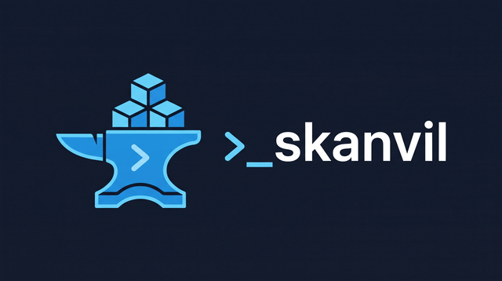

<p align="center">
  
</p>

# skanvil

[](https://github.com/JMBargueno/skanvil/actions/workflows/ci.yml)
[](https://www.npmjs.com/package/skanvil)
[](LICENSE)

**Forge, validate and ship libraries of [Agent Skills](https://agentskills.io/specification).**

skanvil is a CLI and Node.js library for teams that maintain a shared set of agent skills, such as a frontend review checklist, a backend migration playbook or an internal release workflow. Each skill lives in its own `SKILL.md`. skanvil handles the repetitive work around them:

- **Scaffolds and imports** skills from templates (with category prefix, frontmatter, `Error Recovery` table and README entry) or bulk-imports existing folders via `skanvil import`.
- **Keeps everything in sync** when you rename, re-categorise, set `owner`/`status`, deprecate or delete a skill, and reviews PR impact with `skanvil diff`.
- **Validates and measures** every skill against the Agent Skills spec, security checks (`no-secrets`, `no-local-paths`), quality lint rules, duplicate-trigger detection, and 3-stage token budgets (`skanvil stats`), locally or in CI (`--format github`, `--format sarif`).
- **Tests triggers and exports evals.** Simulate routing live with `skanvil eval route`, check `evals.json` triggers offline with `skanvil eval triggers`, promote agent feedback with `skanvil feedback promote`, and export datasets (including `--ablation` baselines for Promptfoo) with `skanvil eval export`.
- **Installs** publishable (non-deprecated) skills across multiple coexisting libraries (`.claude/skills`, `.github/skills`, `.agents/skills`, `.cursor/skills`, `.opencode/skills`, `.windsurf/skills`, `.gemini/skills`) from local folders, npm packages, or Git URLs (`github:org/repo[#ref]`), reporting combined `alwaysLoadedTokens` per target.
- **Adapts and exports skills.** Optional parameters (`{{ticketTracker}}`, `{{#if …}}`) make one skill fit every team, and `skanvil build` turns the library into a typed npm package (`import { codeReview } from "@acme/skills"` with `@deprecated` JSDoc where marked).
- **Teaches agents and captures friction.** skanvil ships `skanvil` (CLI usage) and `skanvil-feedback` (structured `.skanvil-feedback.jsonl` friction reports), so coding agents maintain your library correctly and surface stale instructions.
- **Tracks adoption & usage self-hosted (optional).** Send opt-in snapshots, sync events, friction reports, and non-blocking coding-agent hooks (`claude`, `cursor`, `gemini`) to `skanvil-hub` (under [`hub/`](hub/)) to monitor Stage-1 token growth, zombie skills, friction rates, and deprecated skills still installed.

## What is a skills library?

A git repository (and optionally an npm package) with this layout:

```text
my-skills/
├── skills/
│   ├── front-api-review/      # one folder per skill
│   │   ├── SKILL.md           # YAML frontmatter + instructions
│   │   ├── params.json        # optional parameters (excluded from sync/build)
│   │   ├── evals.json         # optional triggers & cases (excluded from sync/build)
│   │   ├── references/        # optional long-form guidance
│   │   ├── scripts/           # optional helpers
│   │   └── assets/            # optional templates
│   └── back-migrations/
├── .claude/skills/
│   ├── skanvil/               # CLI usage skill, installed by `init`
│   └── skanvil-feedback/      # friction-reporting skill, installed by `init`
├── README.md                  # human-readable index, maintained by skanvil
└── .skanvilrc.json            # categories, validation rules, sync targets
```

Skills are grouped into **categories**, and each category has a folder prefix and a README section. Out of the box these are `front-`, `back-`, prefix-less _transversal_ skills and `_internal` skills. You can define your own categories in `.skanvilrc.json`.

## Install

```bash
npm install --save-dev skanvil     # or run any command with npx skanvil …
```

Requires Node.js 20 or later.

## Quick start

**The easy way: run `npx skanvil`** with no arguments in a terminal. A wizard guides you through it:

```text
$ npx skanvil
skanvil 1.0.0 · interactive mode · Ctrl+C to quit
? This folder (projects) is not a skills library. What do you want to do?
❯ Create a new skills library
  Install skills from a library into this folder
  Install or update the skanvil agent skill
  Exit
```

What the wizard covers:

- **Outside a library:** creating one, with your own categories if you want.
- **Inside a library:** adding, editing, moving and deleting skills, checking and repairing the library, and installing the skills into a project or for your user. Installs show a preview before anything is written.
- **Learning the flags:** after each action it prints the equivalent command, ready for scripts and CI.

**Or let your AI agent do it:** paste the [setup prompt](docs/getting-started.md#0-let-your-ai-agent-learn-skanvil-optional) into Claude Code, Copilot or Codex. It installs the skanvil agent skill and the agent learns the tool, so you can then ask for skills in plain language.

**Author a library with commands:**

```bash
npx skanvil init my-skills --scope acme
cd my-skills && npm install

npx skanvil add --type front --name "API review" \
  --description "Reviews API integration changes for error handling and typing. Use when modifying HTTP clients."
npx skanvil edit front-api-review --rename http-review --type back --owner "@backend-platform"
npx skanvil list
npx skanvil stats --sort tokens
npx skanvil eval triggers --strict
npx skanvil validate --strict
```

**Use it in a project:**

```bash
# from a local checkout
npx skanvil sync ../my-app -C ./my-skills --target claude,copilot

# or from the published package
cd my-app
npm install --save-dev @acme/my-skills skanvil
npx skanvil sync --from @acme/my-skills --target claude

# or from a Git repository
npx skanvil sync --from github:acme/my-skills#v1 --target cursor,claude

# or for every project on your machine (~/.claude/skills, ~/.cursor/skills, ~/.gemini/skills, ...)
npx skanvil sync -C ./my-skills --global --target claude,copilot
```

## Commands

| Command                                | What it does                                                                                                                               |
| -------------------------------------- | ------------------------------------------------------------------------------------------------------------------------------------------ |
| `skanvil` / `skanvil wizard`           | Interactive assistant (in a terminal; without one, `skanvil` prints the help).                                                             |
| `skanvil init [dir]`                   | Create a new library.                                                                                                                      |
| `skanvil add`                          | Create a skill from a template and index it (interactive if options are missing).                                                          |
| `skanvil import <sourceDir>`           | Bulk-import existing skill folders, normalise frontmatter, and index them.                                                                 |
| `skanvil edit <skill>`                 | Rename, re-categorise, retitle, redescribe, set owner/status or remove a skill.                                                            |
| `skanvil list`                         | Table of skills with category, README presence, validity, lifecycle status and summary.                                                    |
| `skanvil validate`                     | Check the spec, security rules, quality rules, evals and conventions (`--format` for CI).                                                  |
| `skanvil diff [baseRef]`               | Compare the working library against a Git ref (Stage-1 token delta, validation, regressions).                                              |
| `skanvil index`                        | Regenerate the README index (`--check` for CI).                                                                                            |
| `skanvil doctor`                       | Diagnose problems; `--fix` repairs what it can (`--scaffold-sections` stubs missing headers).                                              |
| `skanvil stats`                        | Report 3-stage token and line budgets (`name` + `description`, body, resources).                                                           |
| `skanvil eval route "<p>"`             | Simulate Stage-1 offline BM25 trigger routing for a user prompt.                                                                           |
| `skanvil eval triggers`                | Check `evals.json` trigger prompts offline against all descriptions for routing collisions.                                                |
| `skanvil eval run`                     | Run `evals.json` behavioral cases against OpenAI, Anthropic, Gemini, Ollama, or `mock` LLMs (`--ablation`).                                |
| `skanvil eval export`                  | Export `evals.json` cases and triggers as JSON or Promptfoo configs (`--ablation`).                                                        |
| `skanvil feedback list`                | Summarise and deduplicate friction reports recorded in `.skanvil-feedback.jsonl`.                                                          |
| `skanvil feedback promote`             | Promote validated `suggestedEvalCase` entries into skill `evals.json` suites (`--prune`).                                                  |
| `skanvil feedback push`                | Upload sanitized `.skanvil-feedback.jsonl` friction reports to a self-hosted `skanvil-hub`.                                                |
| `skanvil telemetry snapshot`           | Send library token budgets, validation counts, and eval pass rates to `skanvil-hub`.                                                       |
| `skanvil telemetry emit`               | Emit a `skill.invoked` usage event manually or from automation workflows.                                                                  |
| `skanvil telemetry hook`               | Non-blocking agent hook handler reading stdin JSON across all 7 supported coding agents.                                                   |
| `skanvil telemetry push`               | Flush queued offline telemetry events from `~/.skanvil/telemetry-queue.jsonl`.                                                             |
| `skanvil telemetry install-hooks`      | Install non-blocking usage & session-end hooks across 7 agents (`claude`, `cursor`, `gemini`, `copilot`, `windsurf`, `codex`, `opencode`). |
| `skanvil telemetry ingest-transcripts` | Backfill historical `skill.invoked` telemetry from local JSONL/JSON agent transcripts.                                                     |
| `skanvil telemetry audit`              | Audit `skanvil-hub` skill adoption and fail CI on unused zombie skills (`--strict-zombies`).                                               |
| `skanvil templates eject`              | Copy the skill template into the library to customise it.                                                                                  |
| `skanvil sync [dest]`                  | Install publishable skills from local, npm, or Git sources across coexisting libraries (`--frozen`).                                       |
| `skanvil outdated [dest]`              | Check synced Git skill sources against remote upstream commits (`--strict`).                                                               |
| `skanvil install-skill [dest]`         | Install or update the `skanvil` and `skanvil-feedback` agent skills in a project.                                                          |
| `skanvil build`                        | Generate the library's typed npm exports, one function per skill.                                                                          |

Every command accepts `--json`, and every command that works on a library accepts `-C, --cwd <path>`. The [command reference](docs/commands.md) lists every option.

## The skanvil agent skill

skanvil includes an Agent Skill, [`agent-skill/skanvil`](agent-skill/skanvil/SKILL.md), that explains the tool to coding agents. It covers:

- how to recognise a skills library;
- the golden rules: use `add`/`edit` instead of touching folders or the README, and pass every option in non-interactive shells;
- recipes for common tasks;
- how to write good skill content;
- a table from each validation diagnostic to its fix.

`skanvil init` installs it into new libraries, in the configured sync targets (`.claude/skills` by default). To add or refresh it in any repository:

```bash
npx skanvil install-skill --target claude,copilot,agents   # in the current project
npx skanvil install-skill --global --target claude          # for every project
```

`skanvil init` and `skanvil install-skill` also install [`agent-skill/skanvil-feedback`](agent-skill/skanvil-feedback/SKILL.md) by default (pass `--no-feedback` to opt out), enabling agents to log skill friction reports into `.skanvil-feedback.jsonl` for regression testing.

Installed copies are stamped with the skanvil version, so running the command again after upgrading updates them. A `skanvil` or `skanvil-feedback` folder you wrote yourself is never overwritten without `--force`.

## Documentation

| Guide                                                |                                                                                       |
| ---------------------------------------------------- | ------------------------------------------------------------------------------------- |
| [Getting started](docs/getting-started.md)           | Build, validate, publish and consume a library, step by step.                         |
| [Commands](docs/commands.md)                         | Every command, option and exit code.                                                  |
| [Configuration](docs/configuration.md)               | `.skanvilrc.json` reference: categories, validation, templates, sync.                 |
| [Validation rules](docs/validation.md)               | Every rule, its severity and how to tune it. CI recipes.                              |
| [Evals and quality](docs/evals-and-quality.md)       | Token budgets, skill code-smell rules, `evals.json`, ablation export and feedback.    |
| [Telemetry and hub](docs/telemetry-and-hub.md)       | Opt-in CLI telemetry, agent hooks, and self-hosted `skanvil-hub` dashboard (`hub/`).  |
| [Templates](docs/templates.md)                       | Customising the skill template per library or category.                               |
| [Parameters and exports](docs/params-and-exports.md) | Parametrized skills, `sync --param`, and `import { codeReview } from "@acme/skills"`. |
| [Sync](docs/sync.md)                                 | Installing skills into Claude Code, GitHub Copilot and Codex projects.                |
| [API](docs/api.md)                                   | Using skanvil from Node.js.                                                           |
| [Architecture](ARCHITECTURE.md)                      | How the code is organised.                                                            |
| [Contributing](CONTRIBUTING.md)                      | Development setup and conventions.                                                    |

## Programmatic API

```ts
import { Library, scaffoldSkill, validateLibrary, analyzeLibraryStats, syncSkills } from "skanvil";

const lib = await Library.open("./my-skills");
await scaffoldSkill(lib, {
  type: "front",
  name: "a11y",
  description: "Audits UI components for WCAG accessibility. Use when reviewing React views."
});

const { errors } = await validateLibrary(lib);
const stats = await analyzeLibraryStats(lib, { sort: "tokens" });
if (errors === 0) await syncSkills(lib, { dest: "../my-app", targets: ["claude"] });
```

Every export is fully typed and documented; see the [API guide](docs/api.md).

## License

[MIT](LICENSE) © Jose Manuel Bargueño López. See the [changelog](CHANGELOG.md) for release notes.
